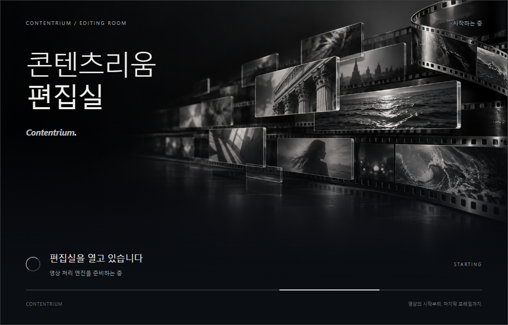

# Contentrium Dev Skill

**데스크톱 앱의 개발부터 설치 화면, 시작 화면, 배포까지 일관되게 만드는 AI 에이전트 스킬입니다.**

[설치 패키지 다운로드](https://github.com/contentriumkorea/contentrium-dev-skill/releases/latest/download/contentrium-dev-skill.zip) · [스킬 본문](skills/contentrium-dev-skill/SKILL.md) · [설치 안내](#설치)

## 설치

Node.js와 Git이 준비된 터미널에서 실행하고 사용할 에이전트를 선택하세요.

```sh
npx skills add contentriumkorea/contentrium-dev-skill --skill contentrium-dev-skill
```

Codex와 Claude Code에 개인용으로 설치하려면:

```sh
npx skills add contentriumkorea/contentrium-dev-skill --skill contentrium-dev-skill --agent codex claude-code --global --copy
```

Cursor, Gemini CLI, GitHub Copilot 등 다른 Agent Skills 지원 도구도 설치 과정에서 선택할 수 있습니다. 지원 목록은 [Skills CLI 안내](https://github.com/vercel-labs/skills#supported-agents)에서 확인하세요. 기존 설치가 있다면 설치 도구의 교체 안내를 확인하세요. 같은 스킬을 여러 경로에 중복 설치하지 않는 것을 권장합니다.

### ZIP으로 직접 설치

위 설치 패키지를 압축 해제하고 **`contentrium-dev-skill` 폴더 전체**를 아래 위치로 복사합니다. `SKILL.md`만 복사하면 이미지와 참고자료가 빠집니다.

| 에이전트 | 개인용 설치 위치 | 프로젝트용 설치 위치 |
| --- | --- | --- |
| Codex | `~/.agents/skills/contentrium-dev-skill/` | `.agents/skills/contentrium-dev-skill/` |
| Claude Code | `~/.claude/skills/contentrium-dev-skill/` | `.claude/skills/contentrium-dev-skill/` |

Windows의 `~`는 사용자 홈 폴더입니다. 다른 에이전트는 해당 제품의 스킬 폴더에 동일한 폴더 전체를 복사하세요. 목록에 나타나지 않으면 새 세션을 열거나 에이전트를 재시작하세요.

### 사용 예시

Codex:

```text
$contentrium-dev-skill 영상 편집용 Windows 데스크톱 앱을 만들어줘. 아직 공개 배포하지 마.
```

Claude Code:

```text
/contentrium-dev-skill 기존 앱의 설치기를 만들고 설치·제거 동작을 확인해줘.
```

다른 에이전트에서는 “Contentrium Dev Skill을 적용해서 작업해줘”라고 요청하거나 해당 도구의 스킬 선택 기능을 사용하세요.

## 무엇을 도와주나요?

- Windows 설치형 앱, 바탕화면 바로가기, 작업표시줄, 트레이 및 정상 제거
- 최신 정식 버전을 내려받는 경량 설치기
- 제작 대상 앱의 경량 설치기·최신 설치용 본체·포터블 ZIP 제공 기준
- 프로그램 기능에 맞춘 설치 화면과 실행 시작 표시
- 요청받은 범위에서의 GitHub 배포와 다운로드 중심 안내
- 새 버전 검증 후 최신 정식 릴리스만 공개하고 이전 릴리스를 초안으로 보관
- 기존 앱을 과하게 바꾸지 않는 수정·검증 기준

**플러그인·스킬·MCP·CLI·웹사이트·웹앱을 데스크톱 앱으로 바꾸는 스킬이 아닙니다.** 개발만 요청하면 공개 배포하지 않으며, 기존 앱의 일부 수정에 전체 신규 제작 기준을 강제하지 않습니다. 다른 OS나 오프라인 설치 방식을 지정하면 그 요구가 우선합니다.

설치기·최신 본체·포터블 ZIP은 이 스킬을 사용해 제작하는 데스크톱 앱의 배포 기준입니다. **Contentrium Dev Skill 자체는 에이전트 스킬 패키지이며 실행 파일이나 프로그램 설치기를 제공하지 않습니다.**

이 스킬 저장소도 최신 정식 릴리스만 공개하고 이전 릴리스는 초안으로 보관합니다. 태그와 커밋은 삭제하지 않으므로 과거 소스 이력은 계속 공개됩니다.

## 승인된 디자인 예시

### 설치 중 화면


### 프로그램 시작 화면



이 예시는 **영상 편집 프로그램**을 위한 것입니다. 화면 구성과 어두운 분위기를 참고하되, 배경은 각 프로그램의 기능에 맞게 새로 만듭니다. 생성 이미지는 배경에만 사용하고 텍스트·버튼·진행 표시는 실제 폰트와 UI로 구현합니다.

패키지에 [HTML 시안](skills/contentrium-dev-skill/references/approved-preview/index.html), CSS, 시연 코드, 배경 이미지와 생성 프롬프트, 최초 참고 이미지가 포함되어 있습니다. 다운로드한 HTML을 브라우저에서 열면 상태 전환을 확인할 수 있습니다. 표시되는 진행률은 디자인 시연용이며 실제 설치 작업을 하지 않습니다.

## 호환성과 필요한 도구

표준 Agent Skills 형식이며 별도 실행 파일이나 서버를 설치하지 않습니다. Codex용 표시 정보는 선택 사항이므로 다른 에이전트의 사용을 막지 않습니다. 이 스킬을 설치한다고 GitHub 인증, 이미지 생성 도구 또는 브라우저가 함께 설치되지는 않습니다. 실제 작업에는 각 환경에서 사용 가능한 도구와 사용자 권한이 필요합니다.

Codex·Claude Code·Cursor·Gemini CLI·GitHub Copilot 대상으로 **격리된 프로젝트 폴더 설치 및 14개 파일의 원본 일치**를 검증했습니다. 공통 경로를 사용하는 에이전트는 같은 설치 폴더를 공유합니다. 모든 에이전트에서 실제 앱 개발·배포 전체를 실행했다는 의미는 아닙니다. 일반 웹 채팅에 파일을 첨부하는 것과 로컬 에이전트에 스킬을 설치하는 것은 다릅니다.

## English quick start

An Agent Skills package for standalone desktop applications: scope-aware development, lightweight installers, cinematic installation/startup UI, and authorized releases. Install with the command above. Copy the complete skill directory to preserve references and previews. Background imagery must match each app's purpose; text and controls remain real UI. No automatic publishing or conversion of plugins/web apps into desktop apps.

## 참고 및 라이선스

- [Codex 스킬 안내](https://developers.openai.com/codex/build-skills)
- [Claude Code 스킬 안내](https://code.claude.com/docs/en/skills)
- [Skills CLI](https://github.com/vercel-labs/skills)
- [MIT License](LICENSE): 본 저장소의 문서와 코드에 적용합니다. 이름·로고 등 상표에 대한 권리는 부여하지 않습니다. 이미지 자료는 디자인 참고용으로 포함되며 제3자 권리를 대신 허가하지 않습니다.
