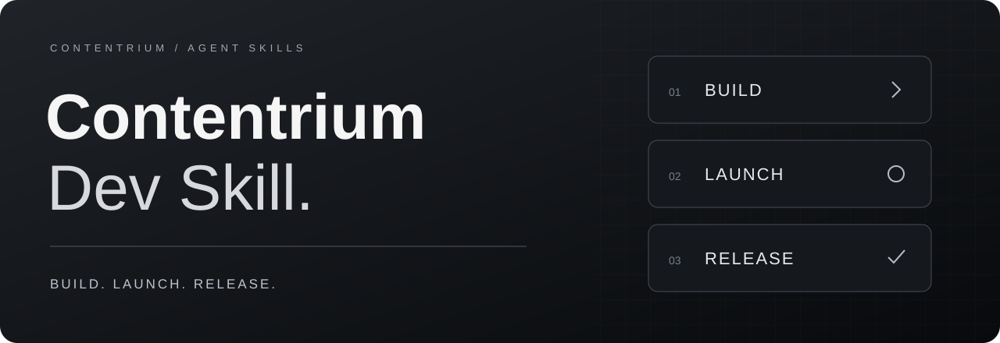

<p align="center">
  
</p>

<h1 align="center">Contentrium Dev Skill</h1>

<p align="center">
  <strong>앱의 첫 실행부터, 사용자에게 닿는 배포까지.</strong><br>
  데스크톱 앱을 만드는 AI 에이전트에게, 완성의 기준을 더합니다.
</p>

<p align="center">
  <a href="https://github.com/contentriumkorea/contentrium-dev-skill/releases/latest"></a>
  <a href="INSTALL.md#호환성과-검증-범위"></a>
  <a href="LICENSE"></a>
</p>

<p align="center">
  <a href="#빠르게-시작하기">설치하기</a> ·
  <a href="https://github.com/contentriumkorea/contentrium-dev-skill/releases/latest/download/contentrium-dev-skill.zip">ZIP 다운로드</a> ·
  <a href="#화면에도-완성의-기준을">디자인 보기</a> ·
  <a href="skills/contentrium-dev-skill/SKILL.md">스킬 본문</a>
</p>

---

## 빠르게 시작하기

Node.js와 Git이 준비된 터미널에서 실행하고, 사용할 에이전트를 선택하세요.

```sh
npx skills add contentriumkorea/contentrium-dev-skill --skill contentrium-dev-skill
```

**Codex · Claude Code · Cursor · Gemini CLI · GitHub Copilot**

[개인용 설치, ZIP 설치 및 업데이트 안내 →](INSTALL.md)

## 개발에서 끝내지 않고, 전달까지

| 01 · BUILD | 02 · LAUNCH | 03 · RELEASE |
| :--- | :--- | :--- |
| **쓰는 사람을 위한 앱** | **시작을 알리는 화면** | **바로 내려받는 배포** |
| 설치·바로가기·트레이·제거까지 확인합니다. | 앱의 기능에 맞는 배경과 실제 UI로 설치·실행 상태를 전달합니다. | 경량 설치기, 최신 본체, 포터블 ZIP을 준비하고 다운로드를 검증합니다. |

## 화면에도 완성의 기준을

<p align="center">
  
</p>

**차분한 무채색. 기능을 담은 배경. 읽을 수 있는 실제 텍스트.**

배경 이미지는 프로그램마다 새로 만듭니다. 텍스트·버튼·진행 표시는 실제 폰트와 UI로 구현하고, 실행 직후에는 시작됐다는 표시를 제공합니다. 시각 효과를 위해 실행을 일부러 늦추지 않습니다.

<details>
<summary><strong>프로그램 시작 화면도 보기</strong></summary>


</details>

위 화면은 영상 편집 도구 **콘텐츠리움 편집실**을 가정한 디자인 시안입니다. 실제 출시된 편집 프로그램이 아니며, 진행률은 시연용입니다.

[HTML 시안과 디자인 자료 →](skills/contentrium-dev-skill/references/approved-preview) · [디자인 기준 →](skills/contentrium-dev-skill/references/design.md)

## 배포는 세 가지 형태로

새로 만드는 데스크톱 앱은 사용자가 설치 방식까지 선택할 수 있게 준비합니다.

| 배포물 | 사용 경험 |
| :--- | :--- |
| **경량 설치기** | 최신 정식 버전을 자동으로 내려받아 설치 |
| **최신 설치용 본체** | 설치기가 연결하는 실제 앱 패키지 |
| **포터블 ZIP** | 압축을 풀고 설치 없이 실행 |

새 릴리스를 검증한 뒤 최신 정식 릴리스만 공개하고, 이전 릴리스는 초안으로 보관합니다. 태그와 커밋은 유지하므로 과거 소스 이력까지 비공개로 바뀌지는 않습니다.

이 기준은 **제작하는 데스크톱 앱**에 적용합니다. Contentrium Dev Skill 자체는 참고자료가 포함된 에이전트 스킬로 설치합니다.

## 이렇게 요청하세요

**Codex**

```text
$contentrium-dev-skill 영상 편집용 Windows 데스크톱 앱을 만들어줘. 아직 공개 배포하지 마.
```

**Claude Code**

```text
/contentrium-dev-skill 기존 앱의 설치기를 만들고 설치·제거 동작을 확인해줘.
```

## 필요한 범위에만 적용합니다

- **독립 실행형 데스크톱 앱**을 위한 스킬입니다. 플러그인·스킬·MCP·CLI·웹앱의 유형을 바꾸지 않습니다.
- 기존 앱의 일부 수정에 신규 제작 기준 전체를 강제하지 않습니다.
- 개발 요청만으로 공개 배포하지 않으며, 인증정보와 비공개 자료를 배포물에 포함하지 않습니다.
- 다른 OS나 오프라인 설치처럼 명시한 요구가 있으면 그 요구를 우선합니다.

<details>
<summary><strong>호환성과 검증 범위</strong></summary>

표준 Agent Skills 형식으로 구성했습니다. 다섯 에이전트 대상으로 격리된 프로젝트 폴더에 설치하고, 참고자료를 포함한 14개 파일의 원본 일치를 확인했습니다. 모든 에이전트에서 실제 앱 개발·배포 전체를 실행했다는 의미는 아닙니다.

GitHub 인증, 이미지 생성, 브라우저 등의 도구는 각 에이전트 환경에서 별도로 사용할 수 있어야 합니다. [상세 안내](INSTALL.md#호환성과-검증-범위)를 확인하세요.

</details>

<details>
<summary><strong>English overview</strong></summary>

An Agent Skills package for standalone desktop apps: scope-aware development, lightweight installers, cinematic installation/startup UI, and authorized releases.

Install with the command above. Keep the entire skill directory to preserve its references. Backgrounds match each app's purpose; text and controls remain real UI. Publishing requires authorization, and existing plugins or web apps retain their original form.

</details>

---

<p align="center">
  <strong>CONTENTRIUM</strong><br>
  <a href="LICENSE">MIT License</a> ·
  <a href="https://github.com/contentriumkorea/contentrium-dev-skill/releases/latest">Latest release</a>
</p>

<sub>MIT는 문서와 코드에 적용합니다. 이름·로고 등 상표에 대한 권리는 부여하지 않습니다. 이미지 자료는 디자인 참고용이며 제3자 권리를 대신 허가하지 않습니다.</sub>
